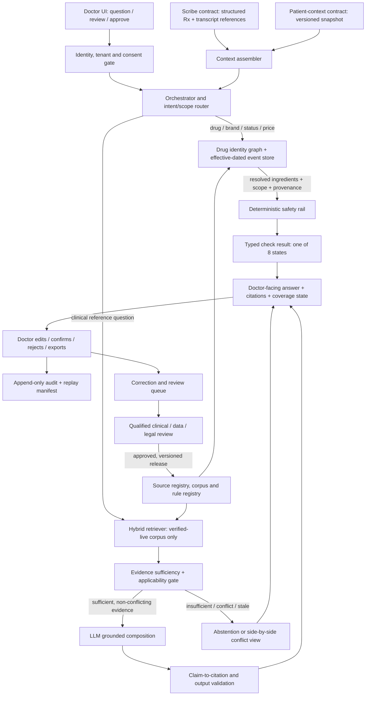

# BRAHMO Clinical AI — Final Architecture and Doctor-Readiness Plan

**Candidate:** Vijaylal Bussa  
**Submission date:** 20 October 2026  
**Assessment opening time:** 20 October 2026, 08:30 IST (drafting session start recorded)  
**Submission time:**   20 October 2026, 11:15 IST
**Version:** Final candidate submission, v1.0

> **Status statement.** This is a proposed architecture and readiness plan, not a claim that BRAHMO is clinically validated, legally approved, licensed for all referenced content, or ready for unrestricted national deployment. The assessment describes A–C as validated at prototype/subset/pilot scale and D–G as in flight, planned, or open; I treat those labels as supplied context, not independent evidence. Regulatory and licensing conclusions below are a research-based engineering position requiring qualified Indian counsel and relevant clinical reviewers to confirm before affected features are enabled.

## S1 · Final Architecture

### 1.1 Architecture decision

I retain a **doctor-facing clinical intelligence layer**, structured-first drug resolution, hybrid retrieval over a permissioned clinical corpus, deterministic medication-safety checks outside the language model, claim-level provenance, explicit abstention, effective-dated regulatory events, and a human approval boundary. I would not replace this with a general-purpose medical chatbot or a custom-trained medical model. The principal changes I make are to formalize contracts and trust boundaries; separate clinical evidence from product/legal status; add source-rights enforcement, tenant-isolated services, a correction/quarantine loop, and immutable release manifests; and make capability coverage visible at query time.

I would implement these as well-defined modules behind authenticated APIs initially, not as a fleet of microservices by default. Deploying every logical responsibility as a separate service would add network failure modes and operational burden before scale evidence exists. The interfaces remain separable so high-volume or independently governed components can be split later without changing the safety contract.

### 1.2 Logical architecture



The diagram is logical, not a mandatory deployment topology. Arrows from source registries into serving systems are one-way release operations: a raw source or correction cannot directly alter live clinical behavior.

### 1.3 End-to-end doctor path

1. **Authenticate and establish scope.** The clinician signs in using a named account with MFA where supported. The service resolves the tenant, role, clinic/device context, consent or other applicable lawful-processing basis, and current authorization. A shared workstation never implies shared patient access. The UI locks after inactivity and requires re-authentication for sensitive actions.
2. **Receive untrusted input.** The Scribe supplies structured prescription entities plus transcript references; it does not supply executable instructions. The patient-context service supplies a versioned snapshot. Imported documents, transcripts, OCR, clinic aliases, and patient-entered text are treated as data, not instructions. The system records the source and timestamp of each input.
3. **Assemble a bounded context.** The context assembler records which fields are present, absent, conflicting, stale, or not authorized. It does not infer missing age, pregnancy status, allergy, diagnosis, renal function, or medication history. The UI asks a targeted clarification only when that field is necessary for the requested reference/check. Otherwise it can answer general reference information while clearly stating that patient-specific applicability was not assessed.
4. **Route by consequence.** Structured requests for drug identity, formulation, ingredient composition, regulatory events, and price go to authoritative structured stores, never to generative text as the source of truth. Clinical reference questions go to retrieval. Mixed requests are decomposed into separate tasks, each with its own source and status.
5. **Retrieve and test sufficiency.** Clinical retrieval uses exact terminology and hybrid lexical/vector retrieval against verified-live, rights-cleared material. A deterministic gate checks question class, population, specialty, formulation, jurisdiction, recency, source status, contradiction and evidence coverage. If evidence is not applicable or sufficient, the system descends only through the approved source ladder or abstains.
6. **Run safety checks independently.** Drug identity must be unambiguous before ingredient-level rules execute. Fixed-dose combinations are decomposed first. The rule service performs only versioned deterministic lookups/rules; it never calls an LLM. Every result returns exactly one of the required eight states. No missing input or missing rule can be displayed as safe.
7. **Compose and validate.** For a supported clinical question, the model drafts an answer from supplied evidence only. A separate validator checks that every consequential claim has a citation to an exact source version and location, that units/numbers match the cited evidence, and that unsupported claims are removed or converted to an explicit inability to confirm. The validator is not itself treated as a clinical oracle.
8. **Clarify, review and decide.** The UI presents a concise answer, source/date/location, applicable population and limitations, source conflicts, drug-resolution confidence/state, and safety-coverage state. The doctor may clarify, inspect evidence, edit the draft, reject it, or confirm it. No diagnosis ranking, patient-specific dose calculation, triage score, or treatment plan is generated. No prescription is sent and no clinical record is finalized without doctor confirmation.
9. **Save/export and audit.** After confirmation, the application saves or exports only the doctor-approved content through an authorized interface. The audit record links input snapshot IDs, retrieved source versions, drug-map and rule versions, model/provider, prompt/template, validator results, UI status, doctor edits/approval, and output hash. Sensitive values are minimized in operational logs. Replay uses pinned artifacts and does not silently re-run against today's data.
10. **Correct without silently learning.** A doctor can flag a wrong mapping, missing source, misleading answer, or alert. The correction becomes a quarantined review item with tenant scope, provenance and impact assessment; it does not modify the canonical drug master, safety rule, or verified corpus until independently reviewed and versioned.

### 1.4 Contracts at integration boundaries

**Scribe input contract (versioned JSON schema).** Required envelope: `schema_version`, `source_system`, `encounter_ref` (pseudonymous), `captured_at`, `tenant_id`, `entities[]`, `transcript_refs[]`, and `provenance`. Each medication entity carries a raw string, optional brand/manufacturer, strength and unit, dosage form, route, frequency/duration if transcribed, and field-level status (`present`, `missing`, `uncertain`, `conflicting`) with source span and confidence. Preserve original text. Do not silently normalize an uncertain entity into a canonical product. Reject unsupported schema versions and quarantine malformed payloads; idempotency keys prevent duplicate ingestion. The Scribe does not decide clinical correctness or safety.

**Patient-context contract (versioned snapshot).** Envelope: `snapshot_id`, `schema_version`, `tenant_id`, pseudonymous patient/encounter reference, `as_of`, field-level provenance, authorization/consent reference where applicable, and explicit completeness. Fields may include age/date-of-birth-derived age, sex where clinically relevant, pregnancy/lactation status, allergies and reaction, active medicines, diagnoses, relevant observations, and relevant history. Each field has `value`, `unit` where applicable, `observed_at`, `source`, and status (`known`, `unknown`, `not collected`, `conflicting`, `stale`). Do not turn unknown into a negative. This contract does not imply that every field is required for every query. The assembler requests only the minimum needed for a specific supported task.

**Drug resolution contract.** Return candidate product IDs, exact ingredient IDs and strengths/forms, match method, evidence/provenance, scope, mapping version and one resolution state. Exact canonical identifier match can resolve if all product dimensions agree; fuzzy spelling, transliteration or alias matching can propose candidates but cannot resolve a clinically material ambiguity. If two products differ by ingredients, strength, release type, route or formulation, return `UNVERIFIED_INPUT` and request clinician selection.

**Safety-check contract.** Input: resolved ingredient list with product dimensions, relevant patient-context fields and their status, current rule-set version, and requested check types. Output: one result per check with exactly one status from the eight-state contract, matched rule IDs if any, rule/data version, source/effective dates, scope, explanation and missing inputs. `HIT` means a rule matched; it is not an autonomous prescribing decision. `CHECKED_NO_HIT` means the defined check ran on adequate input and current coverage and found no match—not that the prescription is universally safe.

### 1.5 Two doctor-facing paths

**Reference-question path — illustrative, non-clinical example.** A doctor asks, “What does the current national workflow say about the assessment section for condition X?” The router identifies a guideline-reference request, retrieves a verified current Indian source, checks population/specialty/date scope, and returns a concise summary with source title, issuing body, edition/effective date and page/section citations. If the relevant section is missing or contradictory, it displays the competing source versions or says it cannot confirm. The example intentionally avoids inventing a clinical recommendation.

**Medication-review path — illustrative example, not a real patient.** A prescription contains two brand strings and one combination product. One brand resolves exactly; the second has two plausible strengths. The first product is decomposed to its verified ingredients; the ambiguous product is not guessed. The duplicate-ingredient check runs only on the verified subset and returns `PARTIAL_COVERAGE` because the unresolved product could change the result. The doctor sees: “One product needs confirmation; duplicate-ingredient review is incomplete. No all-clear has been issued.” Other checks return their own status. The doctor selects the intended product or corrects the prescription; only then is the eligible check re-run. This is safer than either suppressing the warning or asserting a duplicate without adequate identity evidence.

### 1.6 Trust boundaries and material departures

- **P01 retained:** structured stores are authoritative for drug identity, ingredients, regulatory status and price; RAG/LLM cannot override them.
- **P02 retained and tightened:** FDC decomposition precedes checks; cumulative same-ingredient aggregation is only performed where the required regimen fields are reliable. No patient-specific dose calculation is introduced.
- **P03 retained with an explicit policy registry:** source ladders are query-class-specific, not a universal source ranking. Tenant protocols can be shown only within that tenant and cannot silently override a legal restriction or claim national authority.
- **P04 retained:** superseded versions remain replayable but are not served as current; true concurrent conflicts are shown side-by-side.
- **P05 retained:** only verified-live knowledge serves consequential answers; safety-rule content receives 100% qualified review before release.
- **P06 retained:** evidence sufficiency is a hard pre-generation gate, with an independent post-generation claim/citation gate.
- **P07 strengthened:** canonical records are not presumed infallible; contradiction checks and quarantine are described in S3/S6.
- **P08 retained:** inventory availability never establishes legality or clinical suitability; stock, regulatory and price are distinct facts.
- **P09 retained:** population, formulation, route, jurisdiction and effective date are first-class scope fields.

## S2 · Decision Register

| ID / area | Current position or omission → my choice | Why | Strongest rejected alternative | Accepted cost / trade-off | Validation |
|---|---|---|---|---|---|
| D01 Grounding sources | Partial source hints → curated, rights-cleared, source registry with purpose, authority, scope, edition, rights and effective date; only verified-live content serves consequential claims. | Authority depends on question domain; a single universal hierarchy is unsafe. | Index every available PDF/web page and let ranking decide. | Slower coverage expansion; source operations and legal review become a bottleneck. | Source-level gold set, rights audit, supersession tests and clinician approval. |
| D02 Chunking | Token chunks are prohibited → structure-aware decision units preserving headings, tables, footnotes, units, exceptions and cross-references. | Retrieval must preserve meaning and applicability, not just text similarity. | Fixed token windows with overlap. | More complex extraction and chunk maintenance; some long units require parent-child retrieval. | Table/footnote reconstruction tests; exact-quote and citation-location tests. |
| D03 Retrieval | Hybrid retrieval proposed → lexical + dense retrieval, metadata filters, reranking, then evidence-sufficiency/applicability gate. | Brand names, acronyms, local spellings and conceptual queries need different retrieval signals. | Vector-only or keyword-only. | More latency and tuning; reranking can obscure why a result ranked highly. | Recall@k, nDCG/MRR, applicability precision and held-out out-of-corpus abstention. |
| D04 Embedding/index | Index strategy underspecified → versioned embeddings plus lexical index; metadata and source text remain canonical outside the vector store. | Re-embedding should not alter source identity or provenance; retrieval must be reproducible. | One embedding/index updated in place. | Duplicate storage and index rebuild complexity during migrations. | Version-pinned replay, index parity tests, drift tests and rollback rehearsal. |
| D05 Drug data | Curated subset and graph spine → normalized ingredient/product graph, exact product dimensions, alias edges with provenance, FDC composition and effective-dated regulatory event store. | Brand-first India prescribing and FDCs make brand-string matching inadequate. | Use a commercial drug API as sole truth, or infer salts from brand text. | Licensing dependency and unresolved coverage gaps remain; ambiguous products require manual resolution. | Independently held-out mapping key; zero silent wrong mappings; scope and supersession tests. |
| D06 Safety boundary | Deterministic rail retained → pure rules/lookups, no LLM in check path; typed eight-state output and rule version required. | Generative models are not reliable deterministic safety engines. | Ask an LLM to assess interaction risk from retrieved references. | Rule authoring is costly; limited curated coverage must be stated honestly. | Exhaustive unit tests for rules; mutation tests; state reachability; clinician-pharmacologist sign-off. |
| D07 Model/provider | Frontier LLM as composer → provider-agnostic adapter, approved model allowlist, no model authority over structured facts, pinned model/prompt per release. | Avoid coupling and contain silent provider changes. | Self-host an open model or train a medical model immediately. | Provider dependence, API latency and per-request data-transfer risk remain; abstraction adds integration work. | Regression by model/prompt version; contract tests; privacy/security review; fallback visibly degraded. |
| D08 Data residency | Unspecified → India-region hosting for primary patient data by default, encryption and explicit subprocessor review; no claim that this alone proves compliance. | Clinical data sensitivity and clinic trust; provider transfer terms need review. | Global cheapest-region deployment. | Higher operational cost and possible service/model availability limits; cross-border legal analysis still needed. | Data-flow map, vendor DPA/terms, penetration test, backup/restore and counsel sign-off. |
| D09 Multi-tenancy | Tenant baseline → tenant-scoped authorization enforced server-side, tenant IDs on all objects, database row-level controls and negative cross-tenant suites. | Clinic overlays and patient records must never bleed across organizations. | Separate database per tenant from day one, or rely only on UI filtering. | Shared infrastructure has a larger blast radius; database-per-tenant adds operational complexity. | Automated cross-tenant reads/writes/search/cache/export tests and independent security review. |
| D10 Audit/replay | Full audit principle → append-only event trail plus immutable release manifest linking exact source, rule, mapping, model, prompt and validator versions. | A past answer must be explainable and reproducible, including why it abstained. | Store only final answer and timestamps. | Storage, privacy minimization and retention design are more demanding; replay can require archived artifacts. | Byte/hash replay tests, tamper-evidence checks, access review and incident reconstruction exercise. |
| D11 Source conflict | Supersession distinction retained → explicit supersedes/superseded-by links; simultaneous incompatible evidence remains visible, not blended. | An old edition and a concurrent disagreement are different problems. | Always pick newest publication or highest similarity. | Some queries return no single answer, reducing apparent completeness. | Curated conflict set and date/scope adjudication by qualified reviewers. |
| D12 Corrections and canonical poison | Mechanism missing → quarantine, provenance, impact graph, dual approval and versioned re-release; correction never changes serving truth directly. | Even authoritative-looking records can be erroneous or compromised. | Auto-learn from clinician corrections. | Fixes take longer; reviewers need triage tooling. | Seed poisoned rows, duplicate/cross-reference contradictions and verify no live serving before approval. |
| D13 Alert policy | High-severity-only default supplied → clinically reviewed severity tiers, deduplication, suppression only with evidence, acted/dismissed telemetry as a signal not truth. | Alert fatigue harms usability, but dismissal does not prove alert is unnecessary. | Show every possible interaction at equal prominence or optimize solely for click-through. | Some lower-severity findings are not shown prominently; false positives remain possible. | Sensitivity for hard-stop hazards, PPV, overrides, dismissal sampling and clinician review. |
| D14 Offline/degraded mode | Open → offline mode limited to clearly labeled cached, signed, unexpired read-only references; no claim of current regulatory status or live safety checks when dependencies are unavailable. | Offline convenience must not simulate live certainty. | Full offline prescribing/checking with last-known data. | Reduced capability during outages and stale cache expiry. | Network fault injection, cache-expiry tests and doctor usability tests. |
| D15 Languages | Broad multilingual need → accept mixed-language queries with language detection and transliteration-assisted search, but answer only in validated language/capability combinations; source citations remain canonical. | A fluent translation can still distort clinical meaning. | English-only nationally, or unrestricted multilingual generation. | Uneven language coverage and explicit abstentions for unsupported cases. | Per-language clinical review sets, terminology/negation tests and translation fidelity review. |
| D16 Latency | ~2-second aspiration → target first visible status/answer for supported common reference queries, measured end-to-end at p50/p95/p99; safety checks never bypassed for speed. | A single target hides slow tails and dependency failure. | Optimize average latency only. | Some complex queries exceed the target; caching is constrained by freshness and tenant isolation. | Production-like load tests and trace-level stage budgets; report measured values, not promises. |
| D17 Deployment shape | Logical responsibilities → modular monolith or small set of services until measured scale or isolation justifies splitting. | Small team needs fewer failure modes without sacrificing contract boundaries. | Microservice per box in the diagram. | Some modules scale together; later extraction needs careful migration. | Load tests, failure isolation and operational toil review. |
| D18 Source rights | Access treated as a gap → rights matrix per source and use: read, download, store, extract, index, display excerpt, translate, redistribute, train. | Public availability is not a blanket reuse licence. | Assume publicly reachable equals freely reusable. | Some sources cannot be indexed or quoted; coverage may need licensed alternatives. | Counsel-approved rights register and automated source eligibility check at ingestion. |

## S3 · Grounding & Sources Plan

### 3.1 Source catalogue and intended use

I would begin with authoritative Indian sources where they fit the question, then add licensed references only after rights and quality review. Source availability and legal authority are separate from permission to copy, index, display or train on the material. Every entry in the production source registry must contain the issuing organization, canonical URL or identifier, title, edition/publication date, effective date if different, retrieval date, jurisdiction, intended population, specialty, formulation/route scope, status, licence/contract, permitted operations, reviewer, supersession relation and checksum.

| Source / owner | Intended use and authority | Version, coverage and limitations | Rights / serving decision |
|---|---|---|---|
| ICMR Standard Treatment Workflows (STWs), [ICMR official index](https://www.icmr.gov.in/standard-treatment-workflows-stws?q=E%3D) and [STW portal](https://stw.icmr.org.in/) | Primary Indian clinical reference for conditions covered by an applicable workflow; expert-developed workflow documents. | Use the exact current document edition and scope; not every condition, setting or patient is covered. The portal's existence does not prove each workflow is current or universally applicable. | Verify document-specific copyright, terms and reuse permissions before bulk storage/indexing/display. Until cleared, use permitted linking/manual curated excerpts only. No training use without express permission. |
| Ministry of Health and Family Welfare / Clinical Establishments, [Standard Treatment Guidelines](https://www.clinicalestablishments.mohfw.gov.in/en/standard-treatment-guidelines) | Government-published guidelines and national programme materials for their stated domains. | Heterogeneous documents with different dates and scopes; publication on a government site does not mean every item supersedes specialty guidance. | Record each document's terms and issuing authority; obtain legal review for extraction/indexing and excerpt display. |
| National programme guidance: NTEP, National Vector Borne Disease Control Programme / relevant successor programme pages, Universal Immunization Programme and maternal-health programme materials | Domain-specific programme workflows, definitions and public-health policy. | National programme precedence applies only within the defined programme/domain and when the document is current and relevant. | Source-by-source rights and version check; never infer blanket permission from public availability. |
| CDSCO / Ministry of Health and Family Welfare, [Medical Devices page](https://www.cdsco.gov.in/opencms/opencms/en/Medical-Device-Diagnostics/) and [Medical Devices Rules page](https://cdsco.gov.in/opencms/opencms/en/Acts-and-rules/Medical-Devices-Rules) | Medical-device/software regulatory status, rules and notices; not a clinical efficacy reference. | Notifications and guidance have effective dates, scopes and amendment relationships; an old notice may be superseded or stayed. | Preserve Gazette/notification identifiers and official copies. Legal status is served from structured event records with human legal verification for consequential events. |
| CDSCO notifications and Gazette instruments under Drugs and Cosmetics Act, including section 26A orders where applicable | Restrictions/bans and other drug regulatory events. | Must capture affected formulation/composition, scope, effective date, court stays/reversals and superseding events; a news headline or product listing is not enough. | No boolean “banned” field as source of truth. Counsel or qualified regulatory reviewer verifies the event and applicability before release. |
| Indian Pharmacopoeia Commission / Indian Pharmacopoeia (IPC) | Official quality standards and terminology where relevant; adverse drug reaction reporting programme information. | Not a substitute for patient-specific clinical guidance or a comprehensive interaction database. Edition and access conditions matter. | Check subscription/copyright conditions before copying, indexing or displaying monographs. |
| National Pharmaceutical Pricing Authority (NPPA), [DPCO 2013 and price notices](https://nppaindia.nic.in/dpco2013) | Official price-control notices, scheduled formulation ceiling prices and notified retail prices. | Prices are product/strength/unit/notification/date-specific. Historic tables are not current merely because they remain online. | Store the notification and effective date, not scraped prices without provenance. Verify current notice and reuse terms; no inferred market price. |
| Jan Aushadhi / PMBI official product and price information | Availability and price comparison for listed products, where official current data is accessible. | Listing/stock availability is not proof of legal sale status, local stock, equivalence or suitability. | Verify current source, access and reuse terms; display “listed price/availability as of” and do not imply real-time inventory unless integrated and confirmed. |
| National List of Essential Medicines (NLEM), Ministry of Health and Family Welfare | Essential-medicine and pricing-policy context; not a standalone prescribing recommendation. | Versioned list; inclusion does not establish that a product is appropriate for an individual or available locally. | Verify current Gazette/official publication and licence/terms before extraction or indexing. |
| Tenant hospital/clinic protocols, formularies and antibiograms | Local workflow support, labelled as tenant-specific, versioned and scoped. | May conflict with national guidance, be stale, or apply only to a facility/population. Cannot override law or falsely claim national authority. | Contractually authorize processing and tenant-only indexing. No cross-tenant use or model training absent explicit rights. Named clinical owner approves each live version. |
| International reference sources (e.g., WHO guidance or licensed formulary/interaction databases) | Background or fallback where India-specific evidence is absent, visibly labelled non-India and scoped. | Different approvals, epidemiology, formularies, product labels and jurisdiction. Not automatically transferable to Indian practice. | Use only under applicable licence/terms. A licensed interaction database is a dependency candidate, not presumed purchased or available. |
| General model knowledge | Background explanation only where low consequence and explicitly labelled. | May be stale, fabricated or jurisdictionally wrong. Cannot support doses, safety claims, contraindication conclusions or regulatory status. | No claim-level clinical grounding from model memory; no training on patient data by default. |

**Rights matrix.** For each source, I separately record permission to (1) view/access, (2) download/cache, (3) retain the full text, (4) extract tables/metadata, (5) create embeddings or indexes, (6) show excerpts/quotes to doctors, (7) translate, (8) redistribute/export, and (9) use for model training/fine-tuning. An empty or unclear permission is “not cleared,” not implied consent. Training is disabled unless a source's rights and data governance explicitly permit it. A source that cannot be indexed may still be linked or handled through another legally approved route, but it cannot silently enter the serving corpus.

### 3.2 Knowledge lifecycle

1. **Acquire:** ingest from approved source manifests only; record URL/identifier, acquisition time, source checksum, licence/contract reference and fetch method. Reject unapproved hosts and unexpected redirects.
2. **Extract:** retain original bytes and a reproducible extraction artifact. Parse PDF layout, page boundaries, tables, footnotes, equations, units and headings. OCR is labelled as OCR-derived and has confidence; low-confidence consequential text enters manual review.
3. **Normalize:** structure into document → section → decision unit, retaining links to original page, table/row/cell, footnote and related section. Do not discard qualifiers such as “unless,” “except,” “not recommended,” or population exclusions.
4. **Review:** a content reviewer checks extraction fidelity; a qualified clinical reviewer approves consequential clinical meaning; regulatory events require regulatory/legal verification. Safety-rule content gets 100% qualified review before live publication. Independent reviewers cannot approve their own authored change.
5. **Chunk:** create semantic decision units, not arbitrary token windows. Keep the smallest unit that preserves the proposition plus necessary scope, exceptions and table context. Link parent/child chunks for long guidance. Keep a chunk’s citation anchor to page/section/table coordinates.
6. **Version:** assign immutable document, chunk, source and parser versions; record effective dates, retrieval date, status, supersedes/superseded-by edges and a content hash. Never overwrite an old version in place.
7. **Publish:** only approved rights-cleared content can transition to `verified-live`. Raw, extracted, review-pending, rejected, expired and withdrawn tiers cannot serve consequential answers. Release is a signed manifest diff with approver and reason.
8. **Retrieve:** enforce tenant, jurisdiction, language, population, specialty, formulation, date and rights filters before ranking. A high semantic score cannot revive withdrawn or unauthorized content.
9. **Update/withdraw:** source changes create a diff and impact list. Re-run affected extraction, retrieval and answer evaluations. If a safety-critical source is withdrawn or found poisoned, disable affected capability immediately and visibly; keep prior versions for authorized replay under retention policy.
10. **Monitor:** log source misses, citation failures, stale retrievals and correction reports. Expand corpus strategically from observed failures, not bulk token-chunking.

### 3.3 Chunk and citation example

**Illustrative structure only — not a clinical recommendation or a quotation from a real guideline.**

```yaml
chunk_id: fictional-guideline-v3-sec-4-table-2-row-5
source_id: fictional-guideline
source_version: 3
issuer: Fictional example issuer
publication_date: 2026-01-01
effective_from: 2026-02-01
jurisdiction: India
population_scope: adults; pediatric scope explicitly excluded
form_scope: oral formulation only
section_path: "4 > Eligibility > Table 2 > Row 5"
content_unit: "Eligibility condition; exception; required follow-up"
linked_footnotes: ["Table 2 footnote b"]
page_anchor: {page: 12, table: 2, row: 5}
rights_status: approved-for-index-and-display
review_status: verified-live
```

A citation displayed to the doctor would identify the actual issuing body, title, edition/effective date, section and page/table location. It would not cite only a search-result URL or an embedding ID. If the footnote changes the meaning of the row, the footnote is part of the retrieved evidence unit.

### 3.4 Retrieval, applicability and contradiction

I use lexical retrieval for exact drug names, abbreviations, codes and phrases; dense retrieval for semantically phrased questions; metadata filters for scope; and a reranker for candidate ordering. Retrieval relevance asks, “Is this document likely to discuss the query?” Applicability asks, “Does this evidence apply to the question's jurisdiction, population, condition, formulation, route, date and setting?” These are separately evaluated. A relevant pediatric page is not applicable to an adult question merely because it ranks first.

The sufficiency gate checks that the question's required evidence classes are present, source tier is eligible, scope matches, citations resolve, and no unresolved conflict invalidates a single answer. For consequential claims, generation is blocked if this gate fails. A post-generation verifier maps each material claim to cited evidence and checks the citation's exact source version and location. Retrieval relevance is measured with recall@k, MRR/nDCG and reviewer-labelled relevance; applicability and support are measured separately with precision and false-support rates.

### 3.5 Conflict and poisoned-source handling

A source edition superseded by a later official edition is retained for historical replay but excluded from current serving unless a specific historical question asks for it. Two currently applicable sources that disagree are not merged into a synthetic consensus. The UI shows the issuer, date, scope and relevant passages side-by-side and asks the doctor to apply judgment; where no safe comparison is possible, it abstains.

To catch poisoned canonical records, I combine: (a) exact source-to-structured-record extraction checks; (b) duplicate ingredient/product checks across independent records; (c) contradiction rules for mutually exclusive product dimensions; (d) source-change anomaly detection; (e) cross-reference and official-notification reconciliation; and (f) a quarantine queue. These checks raise review tasks; they do not auto-correct clinical truth. A correction requires independent review, a new version, affected-output analysis and a release manifest.

### 3.6 Embeddings and indexing

I would keep canonical text and metadata in a versioned relational/object store, a lexical index for exact matching, and a vector index keyed to immutable chunk/version IDs. Embedding model and preprocessing versions are recorded. Indexes are rebuildable derived artifacts; they are not the source of truth. Re-embedding produces a parallel index, followed by retrieval/evaluation parity checks and controlled promotion. Tenant-specific protocols use physically or logically isolated namespaces and mandatory tenant filters; no tenant corpus can be retrieved by another tenant's request. Cache keys include tenant, authorization scope, query class and corpus/rule release so one tenant's result cannot leak to another.

## S4 · Rules of Behavior for India

### 4.1 Regulatory position and source notes

I would treat the following as a **release-gating legal workstream**, not a blanket compliance claim. The applicable legal answer depends on BRAHMO's exact intended use, features, deployment, contracting parties, data flows and regulatory status at release. My current primary-source research found:

- The Government of India announced the Digital Personal Data Protection Rules, 2025, notified on 14 November 2025. The implementation and commencement of particular provisions must be checked against the Act, Rules and commencement notifications rather than assuming every obligation starts on one date. Official reference: [PIB, “DPDP Rules, 2025 Notified”](https://www.pib.gov.in/PressReleasePage.aspx?PRID=2190655&lang=2&reg=48), 17 November 2025. **Action:** counsel prepares a provision-by-provision commencement and role map before live patient data is processed.
- CDSCO states that medical devices in India are regulated under the Drugs and Cosmetics Act, 1940 and Medical Devices Rules, 2017, and its official site lists a *Guidance document on Medical Device Software under MDR-2017*, Doc. No. CDSCO/MD/GD/MDSW/01/2026, released 21 July 2026. Official references: [CDSCO Medical Device & Diagnostics](https://www.cdsco.gov.in/opencms/opencms/en/Medical-Device-Diagnostics/) and [Medical Devices Rules](https://cdsco.gov.in/opencms/opencms/en/Acts-and-rules/Medical-Devices-Rules). **Action:** qualified regulatory counsel must classify the exact intended purpose and functions; a doctor-in-the-loop disclaimer alone does not establish exemption.
- The NMC site lists the Registered Medical Practitioner (Professional Conduct) Regulations, 2023 and a 23 August 2023 amendment notification keeping the 2 August 2023 regulations in abeyance. Official reference: [NMC rules and regulations](https://www.nmc.org.in/rules-regulations-nmc/1000/). **Action:** do not treat the 2023 text as operative without checking subsequent current instruments and applicable existing professional-conduct rules.
- The Telemedicine Practice Guidelines are a relevant primary reference for registered medical practitioners delivering telemedicine, but BRAHMO's proposed doctor-facing reference/checking tool is not automatically a telemedicine service. Official reference: [NMC-hosted telemedicine guidelines PDF](https://www.nmc.org.in/wp-content/uploads/2023/02/NMC_RMP_Conduct_Regulations_2023.pdf) is a separate RMP conduct document; counsel should locate and verify the operative telemedicine instrument itself before relying on a clause. I do not infer applicability solely from this link.
- NPPA publishes DPCO 2013 materials and price notifications, but historic ceiling-price tables are not a current price feed. Official reference: [NPPA DPCO 2013](https://nppaindia.nic.in/dpco2013). **Action:** each displayed price must resolve to the exact current official notification, product strength/unit and effective date.
- ICMR publishes Standard Treatment Workflows by specialty and condition. Official reference: [ICMR STWs](https://www.icmr.gov.in/standard-treatment-workflows-stws?q=E%3D). **Action:** treat each workflow as a versioned source, not a universal rule that outranks every other source in all settings.

The links above were checked for this assessment on 19 October 2026. This is not a legal opinion. Counsel must verify the Gazette text, amendments, commencement, stays and exact provision numbers before release; I do not invent provision numbers where I have not verified them. Source permissions are a separate question from legal authority.

### 4.2 Enforceable behavior rules

| Condition | Required / prohibited behavior | Evidence / reason | Enforcement | Verification / approval needed |
|---|---|---|---|---|
| Consequential clinical claim requested | Answer only from applicable, verified-live evidence with claim-level citation; otherwise state what cannot be confirmed. | Fixed grounding law; medical-purpose use may trigger additional controls. | Sufficiency gate, claim-citation validator, no-answer path. | Clinician approves source and output policy; legal review of intended use. |
| Dose, numeric regimen or safety statement requested | No generated numeric/safety assertion without exact supporting evidence and scope; no patient-specific dose calculation. | Fixed grounding rule and fence. | Query classifier routes to reference-only mode; numeric claim validator. | Clinical reviewer signs the capability matrix and test cases. |
| Diagnosis ranking, triage/severity score, auto-treatment plan or patient-facing advice requested | Refuse that function; offer an in-scope clinician reference workflow if appropriate. | Fixed fence. | Intent classifier plus server-side capability allowlist; UI has no such endpoint. | Product/legal review of marketing and UI language. |
| Medication identity is ambiguous | Do not auto-resolve. Show candidates and reason code; stop affected check or return `UNVERIFIED_INPUT` / `PARTIAL_COVERAGE`. | Brand collisions, strengths/forms and transliteration can change ingredients. | Exact-dimension matching; ambiguity queue; no fuzzy-match truth. | Drug-data reviewer approves canonical mapping. |
| Check data or patient input is missing/stale | Return correct non-clear state; never display “safe” or “no interaction” if coverage/input is incomplete. | Fixed eight-state contract. | Typed enum and fail-closed UI rendering. | Exhaustive state tests and clinical sign-off. |
| Regulatory status query | Answer only from effective-dated events with official notification, scope, dates and supersession/stay state; otherwise abstain. | Regulatory truth is event-sourced; stock is not legality. | Event store and status resolver; no `banned` boolean. | Regulatory/legal reviewer approves event before live status. |
| Drug appears in stock or a price list | Do not infer legal sale eligibility, quality, clinical suitability or current price from stock alone. | Inventory, legality, price control and suitability are distinct. | Separate inventory, regulatory and price services; source/date labels. | Data owner validates source freshness and matching dimensions. |
| Sources conflict concurrently | Show dated, scoped evidence side-by-side or abstain; do not silently blend. | Fixed source-conflict rule. | Conflict graph and sufficiency gate. | Clinical/editorial adjudication before a preferred source policy is added. |
| Source is superseded, withdrawn, or rights are revoked | Remove from current retrieval eligibility; preserve authorized historical audit/replay as permitted. | Versioning, legal rights and source trust. | Registry status controls retrieval; signed release manifest. | Data steward and counsel approve withdrawal handling. |
| Tenant protocol conflicts with national source | Label it tenant-specific; it cannot override a legal restriction or be represented as national guidance. Surface the conflict. | Tenant overlay is local, not canonical truth. | Tenant-scoped retrieval and precedence policy. | Tenant clinical owner and central clinical governance approve configuration. |
| Patient data is collected or processed | Minimize fields; document purpose, lawful basis, notice/consent where required, retention, rights handling, processors and incident path. No live use until DPDP applicability/commencement is mapped. | DPDP Act/Rules and other applicable health/privacy obligations. | Consent/purpose gate, access controls, retention jobs, audit and processor controls. | Indian privacy counsel/DPO or accountable privacy lead signs data map. |
| Children/guardians or sensitive context is involved | Do not assume adult consent or infer missing guardian/age fields; disable affected workflow until lawful basis, notice/consent and safeguards are verified. | DPDP framework and clinical context require specific treatment. | Context completeness gate and age/guardian policy. | Counsel and clinical reviewer approve the child-data workflow. |
| AI provider receives prompts/context | Send only minimum necessary, approved data; no training/retention by provider unless explicitly reviewed and authorized; contract and region must be verified. | Processor terms and cross-border/data handling risks. | Provider allowlist, redaction, egress policy and configuration attestation. | Security/privacy/legal approval per provider and deployment. |
| Digital record or prescription is exported/signed | Only doctor-confirmed content; clinician credentials remain under clinician control; export provenance identifies AI draft and doctor approval. | Professional accountability; current rules and electronic-record requirements must be verified. | Approval state machine, signed audit event, no autonomous transmission. | Counsel and clinic IT/medical-record owner validate integration. |
| Controlled/scheduled medicine or antimicrobial workflow | Do not expand to prescribing/dispensing automation; display only permitted, current reference information with required restrictions and warnings. | Drugs and Cosmetics Act/rules, applicable schedules and other laws may apply. | Feature allowlist; schedule-aware policy; no order execution. | Regulatory counsel and clinical pharmacologist approve each affected capability. |
| Service is offline, stale or a dependency fails | Show degraded state and last-updated timestamp; do not silently substitute general model knowledge or present cached status as live. | Fixed fail-visible law. | Circuit breakers, freshness TTL, offline capability policy. | Chaos tests and operational acceptance. |
| User submits prompt injection in a transcript/document | Treat it as content; never follow embedded instructions to change policies, reveal data or call tools. | Fixed untrusted-input law. | Input isolation, tool allowlists, structured prompts, injection tests. | Security reviewer signs red-team results. |
| A model, prompt, source, rule or mapping changes | Do not serve the change until its mapped regression passes and release is approved. | Fixed no-silent-upgrade law. | Version-pinned artifacts and release gates. | Independent QA; clinical/legal approval where affected. |

### 4.3 Scope, responsibility and legal blockers

The product's intended use statement should describe it as a clinician-facing reference and medication-review support system, subject to regulatory counsel's classification—not declare it “not a medical device” by product assertion. The boundary between reference software and software with a medical purpose depends on actual intended purpose and functionality. Until counsel has reviewed the current CDSCO Medical Device Software guidance and applicable rules, any affected clinical function remains blocked from live release.

Similarly, DPDP compliance is not satisfied by India-region hosting alone. BRAHMO needs a data-flow map, role allocation (Data Fiduciary/processor as applicable), purpose and notice, lawful basis/consent where required, data principal request handling, child-data handling, retention/deletion rules, breach response, processor contracts, security safeguards and any applicable transfer/other statutory analysis. The precise obligations and commencement dates require counsel to check the final Act, Rules and notifications. Existing clinical-establishment, health-record, professional, consumer, cyber-security and drug-law obligations may also apply depending on deployment; counsel should produce a feature-by-feature applicability matrix rather than a generic “compliant” badge.

## S5 · Correctness & Safety Design

### 5.1 Deterministic versus generated behavior

**Deterministic:** identity and tenant authorization; schema validation; product/ingredient resolution once exact criteria pass; FDC decomposition from verified composition; regulatory-event resolution; source/version eligibility; freshness checks; safety-rule execution; status mapping; citation anchor resolution; release gating; audit hashing; and export approval state. Deterministic services return structured outputs and do not invoke a model.

**Generated:** a concise natural-language explanation of retrieved evidence, reformulation of a doctor’s question, and draft summaries from approved source chunks. Generated content cannot create drug identity, legal status, dose, safety result or a new clinical rule. It cannot change a deterministic result. If the generated wording cannot be grounded claim by claim, it is withheld or converted to a transparent abstention.

### 5.2 Eight-state check contract

Every medication check returns exactly one status:

- `HIT` — a current, applicable rule matched. Display the rule and source; do not automatically alter the prescription.
- `CHECKED_NO_HIT` — the defined check ran with adequate inputs and the rule set's declared coverage; no rule matched. This is not a universal safety guarantee.
- `PARTIAL_COVERAGE` — some relevant inputs/rules are unavailable or unresolved, so the check cannot be considered complete.
- `UNVERIFIED_INPUT` — a required input or product identity is not sufficiently verified.
- `NOT_CHECKED` — this check was not run, for a known reason such as unsupported capability or user not requesting it.
- `DATA_EXPIRED` — required rule/source data exceeded its validity/freshness policy.
- `SOURCE_CONFLICT` — applicable source records conflict and have not been resolved under policy.
- `SERVICE_UNAVAILABLE` — the service could not complete the check.

The UI must display the state and reason, including on export. Only `CHECKED_NO_HIT` can be rendered as “no match found in the stated check coverage,” never “safe.” Every other state is visibly non-clear. The status contract is an enum, not free text, and the backend rejects unknown values. Monitoring alerts when a state is missing, mapped incorrectly or suppressed.

### 5.3 Drug identity and rule coverage

Canonical identity is a product-level object: brand/manufacturer where known, exact ingredients/salts, strength per unit, dosage form, route, release type, pack and market scope, with source and effective date. Alias relationships are evidence-backed edges, not equality assumptions. FDC products expand to all verified ingredients before any duplicate or interaction check. Ingredient normalization handles salt/base distinctions explicitly and only applies a conversion when an approved mapping and unit rule exist. The system does not assume two products are equivalent merely because brand names look alike.

A curated critical safety set is a legitimate initial boundary only if the UI discloses its coverage and the supported checks are narrow and validated. It is not represented as a comprehensive interaction database. For an incomplete set, the result must be `PARTIAL_COVERAGE` or another applicable non-clear state. The scale-up/licensing trigger is based on coverage gaps and risk analysis, not a marketing deadline. If the curated set cannot support a requested check, the product says so rather than manufacturing an answer.

### 5.4 Context, uncertainty and correction

Each field has its own status, provenance and time. “Not documented” is not “absent”; “no known allergy recorded” is not “no allergy”; and an old medication list is not necessarily current. If an input is clinically necessary, ask a targeted clarification and explain why. If it is not necessary for a general reference question, answer only the general question and state the limitation. Conflicting patient data is shown to the doctor and never resolved by the model.

Doctor corrections are captured with one-tap categories (wrong identity, missing ingredient, wrong source, unsupported claim, irrelevant alert, stale data, language/translation, other) plus optional note. The event includes tenant, time, output/version IDs and selected correction, but not unnecessary free-text PHI. It enters a role-restricted queue. A correction to an individual encounter can update that encounter after doctor confirmation; a correction to canonical knowledge requires independent data/clinical review, impact analysis, version bump and regression. Patient-context changes produce a new snapshot rather than mutate a past snapshot.

### 5.5 Access, tenancy, language and degraded operation

Authorization is checked server-side at every read/write/search/export boundary. Tenant IDs are derived from authenticated claims, not trusted from client payloads. Row-level controls, tenant-scoped object paths, separate encryption/key policy where justified, cache partitioning, audit access controls and negative cross-tenant tests are mandatory. Organization overlays cannot leak into global retrieval. Break-glass access, if enabled by a clinic, requires a reason, time limit, alert and audit; otherwise it is unavailable.

Mixed English/Hindi/Telugu/Tamil/Kannada input can be accepted as an input capability, but transliteration and translation are aids to search, not identity truth. Preserve the original script and normalized alternatives with provenance. Clinical negation, decimal/unit, strength, frequency and ingredient terminology require language-specific tests. The output may be in a language only where the clinical vocabulary and source display have been validated; otherwise provide the original evidence and a clear limitation. There is no patient-facing AI advice surface.

During connectivity failure, the UI identifies which capabilities are offline, last synchronization time and data age. Only signed, cached, rights-cleared, unexpired reference material may be shown read-only. Regulatory status and safety checks requiring live/current data become `DATA_EXPIRED` or `SERVICE_UNAVAILABLE` according to the failure. There is no quiet fallback to model memory. Exports are queued only if the clinic's approved workflow permits it, with no claim of successful save until acknowledged by the receiving system.

### 5.6 Audit and replay

For each response, persist a minimal audit envelope: pseudonymous encounter reference, tenant/user/role, timestamps, request type, context snapshot ID, input hashes, source/chunk versions and anchors, retrieval candidates and scores, sufficiency/applicability decisions, drug-map/rule versions and states, model/provider identifier, prompt/template hash, validator findings, displayed output hash, user edits, confirmation/export acknowledgement, and incident/correction links. Keep PHI out of general application logs and traces; restrict audit access and apply a legally reviewed retention schedule.

A replay manifest pins all artifacts necessary to reconstruct the decision. Where a provider does not guarantee bit-for-bit deterministic model output, the record must distinguish **decision replay** (same inputs, sources, rules, configuration and expected control decisions) from exact text reproduction. Store the original output and its hash; never claim byte-identical generation unless tested. Audit access itself is audited. Data retention, erasure and legal hold must be reconciled with replay obligations by counsel rather than silently retaining everything forever.

## S6 · What You Added

| Factor | Current section / omission | Consequence | Severity | Proposed handling and link |
|---|---|---|---|---|
| Intended-use and medical-device classification | S4 only names the issue; no exact feature-classification gate. | A disclaimer may not address regulatory obligations for medical-purpose software. | Critical | Feature-by-feature intended-purpose memo and CDSCO MDR/MDSW review before affected live functions; S4. |
| Rights enforcement at ingestion | Source-rights question is open. | Unauthorized storage, embeddings, excerpt display or training can create legal and continuity risk. | Critical | Machine-readable rights matrix blocks each operation independently; S3/S8. |
| Source freshness SLA and expiry semantics | “Verified-live” lacks operational expiry thresholds. | Old guidance or regulatory status may look current. | Critical | Per-source freshness class, validity/expiry policy, stale-state behavior and owner; D01/D11 and S7. |
| Canonical poison detection | P07 states a need but no mechanism. | A single bad master row can corrupt many checks. | Critical | Independent reconciliation, contradiction rules, quarantine, impact graph and dual approval; S3/S7. |
| Claim granularity and citation coverage | Claim-level provenance required but no exact validator contract. | A citation at paragraph end can fail to support one critical number. | Critical | Split outputs into atomic claims, anchor each consequential claim, verify quotes/units and block unsupported claims; S1/S7. |
| Rule coverage declaration | Curated set could be mistaken for comprehensive. | Doctors may interpret absence of alert as assurance. | Critical | Rule-set coverage manifest, explicit excluded classes and partial-coverage state; S5/S8. |
| Regulatory event lifecycle | Event sourcing specified, but stays, reversals, scope and supersession need governance. | A banned/allowed state may be wrong after litigation or amendment. | Critical | Event graph with source notification, effective intervals, court-event links and qualified review; S3/S4. |
| Tenant-specific cache and vector leakage | Tenant baseline does not specify every derived layer. | Cross-clinic PHI/protocol exposure. | Critical | Tenant in authorization, index namespace, cache key, storage path and audit; automated negative tests; S2/S7. |
| Provider data use and subprocessor drift | Provider posture is open. | PHI may be retained, trained on or routed to an unapproved region. | Critical | Approved provider/region/config registry, contract review, egress minimization and attestation; S2/S4/S8. |
| Patient correction vs canonical correction | One-tap loop could accidentally change shared truth. | Local edits can become unsafe global facts. | High | Separate encounter correction and canonical review queues; two-person approval for shared knowledge; S5. |
| Clinical alert governance | Acted/dismissed telemetry is proposed. | Clicks and dismissals can reward noisy or unsafe behavior. | High | Review telemetry alongside severity, PPV, sensitivity and sampled clinician adjudication; never use dismissal alone to suppress; S2/S7. |
| Incident response and rollback semantics | Runbook and rollback are mentioned but no trigger model. | A dangerous source/model update may remain active. | Critical | Immediate disable by capability/version, source withdrawal, incident severity, notification and replay procedure; S7/S8. |
| Offline mode semantics | Offline operation is open. | Cached data can masquerade as current. | High | Read-only cache with signature/expiry and visibly degraded status; disable live-dependent checks; S5/S7. |
| Multilingual clinical error modes | Broad language requirement, limited scale plan. | Negation, units, transliteration or dosage-form errors can change meaning. | High | Per-language validated scope; preserve source text; tests for negation, numbers, units and code-switching; S5/S7. |
| Human factors and alert fatigue | High-severity defaults but no denominator/threshold. | Important alerts may be ignored or buried. | High | Measure eligible alerts, true positives, actions, overrides and sampled false negatives; clinician-approved thresholds; S7. |
| Security supply chain and prompt injection | Injection corpus exists; supply-chain controls are underdeveloped. | Malicious dependency, document or prompt could exfiltrate data or alter output. | High | Dependency/SBOM review, signed artifacts, least privilege, tool allowlist, red-team corpus and secrets scanning; S5/S7. |
| Availability and dependency failure | Latency aspiration but no end-to-end SLO decomposition. | Silent partial results or timeouts degrade trust. | High | Trace stages, timeouts/circuit breakers, explicit service-unavailable states and measured p95/p99; S2/S7. |
| Clinical coverage claims | All-India ambition may be confused with validation. | Marketing could imply validated support for all specialties/languages. | Critical | Public/internal capability matrix by specialty, population, source and language; no “nationally validated” claim without evidence; S7/S8. |
| Export/record ownership | Doctor approval mentioned, receiving-system acknowledgment unspecified. | A draft may be mistaken for a saved or signed record. | High | State machine distinguishes draft, doctor-confirmed, transmitted, acknowledged and failed; S1/S5/S8. |
| Privacy-safe observability | PHI-in-logs scan planned but insufficient alone. | Telemetry and error traces may leak sensitive data. | High | Field allowlists, structured redaction, sampling review, retention/access policy and automated PHI scans; S5/S7. |
| Clinical reviewer independence | Qualified reviewers exist, but independence from implementation/evaluation needs protection. | Self-authored rules/tests can pass without detecting the intended failure. | Critical | Independent held-out keys and no self-approval for safety/security PRs; S7/S8. |

## S7 · Validation & QA Plan

### 7.1 Evaluation governance and datasets

I would maintain separate, versioned datasets for (a) retrieval relevance, (b) clinical applicability, (c) claim support/citations, (d) drug identity and FDC composition, (e) deterministic safety rules, (f) regulatory-event interpretation, (g) multilingual normalization, (h) privacy/security and tenant isolation, and (i) end-to-end doctor workflow. Every case has provenance, intended capability, scope, expected answer or abstention, severity, source version and reviewer. Clinical reference answers are authored or approved by qualified reviewers; engineering-generated examples are useful for development but are not independent gold standards.

Split by source/document family, product family, condition and time where practical to reduce leakage. Maintain an independently held-out set whose answer keys are controlled outside the implementer. Include adversarial cases: misspelled/transliterated brands, near-identical formulations, hidden ingredients in FDCs, stale or withdrawn guidance, contradictory current sources, unsupported questions, prompt injection in transcripts, missing allergies, stale medication lists, service outage, rights-ineligible sources and cross-tenant attempts. Do not edit an expected answer merely to make a release pass; changes to a key require reviewer rationale and version history.

### 7.2 Metrics and gates

“Confidently wrong” means a consequential unsupported or incorrect claim presented without an appropriate uncertainty signal, including a wrong identity/status or an unknown rendered as clear. Denominator: all adjudicated test outputs in the capability under evaluation; also report the count and severity-weighted breakdown. “Useful supported answer” means the answer addresses the requested question, is applicable, and every consequential claim is supported by the cited source. Denominator: all in-scope answerable cases, with separate reporting for abstentions. “Appropriate abstention” means the system refuses or qualifies a case where evidence, applicability, identity, freshness or service state is insufficient. Denominator: all cases independently labelled unanswerable/unsupported/ambiguous. Report confidence intervals and raw counts; do not hide failures in an aggregate score.

Hard release blockers are not averaged away:

- **Zero silent wrong drug mappings** on the held-out mapping key; every unresolved material ambiguity remains unresolved visibly.
- **Zero unknown-as-safe results** across all eight safety states, fault injections and UI/export paths.
- **Zero uncited consequential claims** and zero citations that point to the wrong source version/location in the release-blocking set.
- **Zero cross-tenant data or index leakage** in negative tests.
- **Zero unlabeled general-knowledge answers** where the source ladder has fallen back to background content.
- **100% reachability and correct rendering** of the eight states, including missing, stale, conflict and service-down cases.
- All clinical safety-rule changes receive 100% qualified review before publication; sampling is not acceptable for the safety content itself.
- No high-severity seeded regression, rights violation, unresolved critical security finding, or unapproved model/source/rule change may ship.

For non-catastrophic metrics, thresholds must be set before a release by QA and qualified reviewers based on the supported scope and baseline, not selected after seeing results. I would track retrieval Recall@k/MRR/nDCG; applicability precision; claim-level citation precision/recall; abstention precision/recall; wrong-identity rate; sensitivity/PPV by safety-rule class; alert burden per reviewed prescription; correction rate; source staleness; p50/p95/p99 latency; service availability; and doctor edit/override patterns. Any numeric target not yet measured is a proposed gate, not a claimed result.

### 7.3 Capability test matrix

| Capability | Test data / reference standard | Method | Pass criterion | Evidence | Validator |
|---|---|---|---|---|---|
| Clinical retrieval | Clinician-labelled questions, source passages and unanswerable controls | Recall@k, MRR/nDCG; source/scope filters; adversarial query tests | Pre-registered target met for each capability; no rights-ineligible or withdrawn chunk served | Dataset/version, rankings, traces, error analysis | QA + clinical content reviewer |
| Applicability | Cases labelled for population, specialty, formulation, jurisdiction, date and setting | Compare gate decisions against independently reviewed labels | No release-blocking wrong-scope use; all uncertain scope abstains or labels limitation | Applicability confusion matrix and case IDs | Independent clinician |
| Claim support | Atomic claims with source/version/page/section gold anchors | Claim extraction and manual adjudication; number/unit checks | Zero uncited consequential claims in release-blocking set; citations resolve exactly | Claim-level report and source snapshots | QA + clinician |
| Drug mapping/FDC | Independent product catalogue and held-out brand/ingredient key | Exact, typo, transliteration, strength/form collision and FDC tests | Zero silent wrong mappings; all ambiguity states correct | Mapping report, queue items, version manifest | Drug-data reviewer + QA |
| Safety rail | Clinician-approved rules and synthetic boundary cases | Unit, property, mutation and integration tests; no LLM call instrumentation | All expected states correct; no unknown-as-safe; rules versioned | Test run, code review, rule sign-off | Clinical pharmacologist + independent QA |
| Regulatory status | Official notifications, amendments, stays, reversals and scope variants | Event chronology replay and counterfactual dates | Correct effective-date answer or abstention; no boolean-only inference | Event ledger and adjudication sheet | Regulatory reviewer/counsel |
| Multilingual parsing | Clinician-reviewed mixed-language and transliterated input set | Negation, numeral/unit, formulation and code-switch testing | Only validated language-scope passes; unresolved identity stays ambiguous | Per-language scorecard and errors | Language reviewer + clinician |
| Tenant isolation | Two or more synthetic tenants, separate overlays, cache/index/export paths | Negative authorization tests and penetration testing | Zero cross-tenant reads/writes/search results/cache leakage | Security test report | Security reviewer independent of feature author |
| Prompt injection | Malicious instructions in documents, transcript, OCR and source text | Red-team corpus, tool-call and exfiltration monitoring | No policy override, cross-tenant disclosure or unauthorized action | Red-team cases and traces | Security reviewer |
| Degraded service | Network, vector store, model, drug service and event feed failures | Fault injection, expiry and recovery tests | Correct visible degraded state; no quiet fallback; no stale “clear” result | Chaos test report and UI captures | QA + operations |
| Audit/replay | Golden-thread encounters with pinned versions | Reconstruct decision and compare inputs, statuses, citations, output hash | Control decisions and artifact provenance replay; exact text only claimed if demonstrated | Replay manifest and hash report | QA + audit/security owner |
| Doctor workflow | Simulated consults with intended user roles and shared devices | Usability observation, task completion, confusion/alert review | No unresolved critical use error; doctor can distinguish draft, partial and confirmed states | Session notes and issue log | Clinical lead + product/UX |
| Privacy/legal | Data map, processor terms, retention and rights workflows | Configuration audit, access tests, deletion/retention exercise | No live PHI until applicable legal controls are approved; no unapproved provider egress | Counsel memo, config evidence, test results | Privacy/legal owner |

### 7.4 QA operations and scale

**Daily QA duties:** review production safety-state anomalies, high-severity alert/correction reports, source-feed failures, unexpected abstention spikes, provider/model changes, privacy/security alerts and failed export acknowledgements. Triage by potential harm and disable an affected capability when its evidence or rule integrity is in doubt.

**Weekly QA duties:** sample supported answers and abstentions stratified by specialty, language, source tier, tenant and query type; audit claim citations; review doctor corrections and alert overrides; inspect source freshness and coverage gaps; review drift and latency; verify that no unapproved release is serving. Sampling helps monitor generated answers, but it does not replace 100% qualified review of safety-rule content before release.

**Production sampling:** sample by risk, not only random volume. Include every high-severity incident and source/rule change, plus random low-risk cases to estimate ordinary failure rates. Report denominators and confidence intervals. Do not use clinician acceptance as proof of correctness; clinicians may miss an error. Patient data used for QA must have a documented lawful basis, access control and minimization, and should be de-identified or synthetic where feasible.

**Revalidation triggers:** any model/provider version, prompt, retrieval/reranker, embedding, source edition, source rights, drug mapping, FDC composition, safety rule, regulatory event, language model/normalizer, tenant precedence or export contract change triggers its mapped regression. A high-impact change requires full end-to-end golden-thread and held-out evaluation. Promotion is blocked until independent QA approves the evidence and the relevant clinical/legal reviewer signs the affected capability. Rollback restores the previous approved manifest and disables the changed capability if rollback integrity cannot be proven.

**All-India quality without reviewing every answer manually:** use risk-based sampling and automatic hard gates for all outputs, plus 100% review of safety-rule changes and targeted review of new source families. Keep capability coverage narrow and explicit; use correction and miss logs to prioritize the next source or specialty. Qualified reviewers approve content and policies, while QA automates reproducible technical tests. Do not claim universal validation from a small pilot. The operating dashboard must show validated coverage by specialty, population, language, source family and feature, alongside unvalidated or disabled areas.

### 7.5 Latency and service objectives

The roughly two-second aspiration applies to the **first useful, grounded response for a supported common reference query**, not to every complex request, full evidence inspection or external save acknowledgement. Measure end-to-end p50/p95/p99 and stage spans for authentication/context assembly, retrieval, sufficiency, model generation, citation validation and rendering. Safety checks and validation are not skipped to meet latency. Use bounded timeouts and visibly partial/degraded status when a dependency misses its budget. Establish numeric service objectives only after representative load tests and supervised usage; report actual results with test environment and date.

## S8 · Doctor-Handover Checklist

A checkbox is complete only when the required evidence exists and the named accountable reviewer has approved it. “Prototype validated” is not clinical/legal approval. National availability is not validated coverage. The following checklist is the release gate for each capability and deployment, not a claim that any item is already complete.

| Item | Required result | Verification / evidence | Responsible validator / approver | Handover blocker? |
|---|---|---|---|---|
| Intended use and classification | Approved description of exact in-scope functions and regulatory pathway | Feature-classification memo, current CDSCO source review, documented limitations | Indian regulatory counsel + product owner | Yes |
| Clinical scope | Explicit capability matrix by specialty, population, language, source and query class | Signed clinical coverage matrix; unsupported areas listed | Clinical lead / qualified reviewers | Yes |
| Clinical evidence | Every serving source is verified-live, in scope and current | Source registry, version/date, reviewer sign-off, expiry policy | Clinical content owner | Yes |
| Source rights | Permission documented for access, storage, extraction, indexing, excerpt, translation, export and training separately | Rights register and contracts/terms review | Legal counsel + data steward | Yes |
| Drug master | Product identity, ingredients, strengths, forms, FDCs and alias provenance validated for released scope | Held-out mapping results; ambiguity queue; zero silent wrong mappings | Drug-data owner + clinical pharmacologist | Yes |
| Safety rules | Released rules independently reviewed and versioned; eight-state behavior correct | Rule inventory, 100% sign-off, test evidence and coverage manifest | Clinical pharmacologist + independent QA | Yes |
| Regulatory events | Current events include official source, effective dates, scope, stays/reversals and supersession | Event ledger and legal/regulatory approval | Regulatory reviewer / counsel | Yes |
| Patient-context contract | Unknown/stale/conflicting values remain explicit; only minimum necessary fields used | Schema conformance tests, data map and sample snapshots | Integration owner + privacy lead | Yes |
| Scribe integration | Versioned payloads, provenance, idempotency and error handling verified | Contract tests and malformed/duplicate payload tests | Scribe/integration owner + QA | Yes |
| Security and tenancy | Auth, role controls, tenant isolation, encryption, secret management and break-glass policy verified | Pen test, negative cross-tenant suite, access review | Independent security reviewer | Yes |
| Privacy | Applicable DPDP and other legal obligations mapped; notice/consent or other lawful basis, retention, rights and incident process ready | Counsel-approved data-flow and privacy assessment; processor terms | Privacy/legal owner | Yes |
| Provider configuration | Approved model, region, retention/training settings and subprocessors pinned | Contract/configuration attestation, egress tests | Security + privacy/legal | Yes |
| Citations and UI | Doctor sees source/date/location, applicability, uncertainty and all non-clear states; draft distinct from approved record | UI acceptance tests and simulated consultations | Clinical UX owner + QA | Yes |
| Language scope | Every enabled language/translation pathway tested for negation, units, numbers and terminology | Per-language validation report and limitations | Clinical language reviewer | Yes for each enabled language |
| Degraded/offline behavior | No stale/live confusion; unavailable services visibly degrade; no quiet fallback | Fault-injection results and usability evidence | Operations + QA + clinical lead | Yes |
| Audit/replay | Required versions, approvals and source anchors recorded; replay semantics documented | Golden-thread replay report, retention policy, audit access review | QA + security/audit owner | Yes |
| Export and record system | Doctor confirmation required; success/failure acknowledged; signature/credential remains clinician-controlled | Integration contract tests, failed-export tests, clinic approval | Clinic IT/records owner + counsel | Yes |
| Evaluation gates | Independent held-out sets, pre-registered thresholds and hard blockers pass | Signed release report, raw counts, error analysis, regression manifest | Independent QA; clinical/legal sign-off for relevant areas | Yes |
| Incident and rollback | Named on-call/owner roles, severity triggers, source withdrawal, disable/rollback and communication process tested | Runbook, tabletop exercise, release manifest and rollback evidence | Operations owner + clinical safety lead | Yes |
| Support and instructions | Concise doctor guide explains supported use, non-supported use, state meanings, citations, corrections, offline behavior and support route | Approved user guide, in-product help, support contact and escalation procedure | Product owner + clinical lead | Yes |
| Monitoring | Dashboard covers stale sources, partial coverage, abstentions, alert overrides, latency, provider errors and corrections | Operational dashboard review and alert test | QA/operations owner | Yes |
| Organizational approval | Named accountable owners and independent reviewers; no self-approval of critical changes | Responsibility matrix, signed approvals, access roster | BRAHMO accountable executive / governance owner | Yes |

### Handover decision

A capability may be enabled only when all relevant blockers are cleared for its exact scope. If one specialty or language is not validated, the product should not imply it is validated; however, that limitation does not justify disabling unrelated, independently validated capabilities. The release manifest must list enabled capabilities and known exclusions. Any missing legal, clinical, source-rights or security approval means that affected capability remains disabled—not that the checkbox is assumed complete.

## S9 · AI-Usage Note

I used an AI assistant to structure the assessment, develop candidate architecture decisions, draft the nine sections and identify primary-source research leads; I reviewed the output against the supplied assessment requirements.  
I independently checked official CDSCO, ICMR, NMC, NPPA and Government of India source pages and made legal status, source rights and clinical approval explicit release gates rather than asserting blanket compliance.  
The most important remaining uncertainty is the final legal classification and provision-by-provision applicability of BRAHMO's exact intended use, data flows and enabled features, which require current Indian counsel and qualified clinical review.

## References

1. Government of India, Press Information Bureau, “DPDP Rules, 2025 Notified,” 17 November 2025: https://www.pib.gov.in/PressReleasePage.aspx?PRID=2190655&lang=2&reg=48
2. Central Drugs Standard Control Organisation, Medical Device & Diagnostics (includes Medical Device Software guidance, Doc. No. CDSCO/MD/GD/MDSW/01/2026, listed as released 21 July 2026): https://www.cdsco.gov.in/opencms/opencms/en/Medical-Device-Diagnostics/
3. Central Drugs Standard Control Organisation, Medical Devices Rules: https://cdsco.gov.in/opencms/opencms/en/Acts-and-rules/Medical-Devices-Rules
4. National Medical Commission, Rules and Regulations index (lists 2023 RMP Professional Conduct Regulations and the notification keeping them in abeyance): https://www.nmc.org.in/rules-regulations-nmc/1000/
5. Indian Council of Medical Research, Standard Treatment Workflows: https://www.icmr.gov.in/standard-treatment-workflows-stws?q=E%3D
6. ICMR Standard Treatment Workflows portal: https://stw.icmr.org.in/
7. Ministry of Health and Family Welfare / Clinical Establishments, Standard Treatment Guidelines: https://www.clinicalestablishments.mohfw.gov.in/en/standard-treatment-guidelines
8. National Pharmaceutical Pricing Authority, DPCO 2013: https://nppaindia.nic.in/dpco2013
9. National Medical Commission-hosted document page used as a research lead for RMP conduct; not treated as proof of the currently operative telemedicine instrument: https://www.nmc.org.in/wp-content/uploads/2023/02/NMC_RMP_Conduct_Regulations_2023.pdf

**Research note:** Official webpages and their current listings were checked on 19 October 2026. This submission intentionally does not invent legal provision numbers, source licences, completed benchmarks, clinician sign-offs or production-readiness facts not established by the supplied pack or verified source material.
